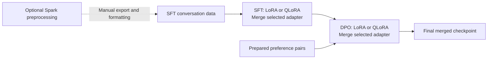
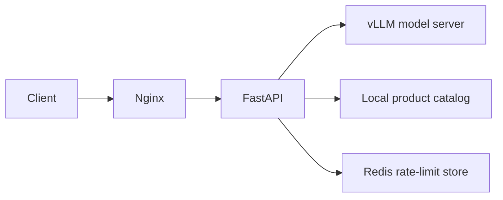

# PostTrainX — LLM Post-Training and Serving

PostTrainX is a reference project for adapting **Qwen2.5-0.5B**, comparing LoRA and QLoRA training, and serving the selected model through an API. It covers supervised fine-tuning (SFT), preference alignment with Direct Preference Optimization (DPO), adapter merging, and inference benchmarking.

The application example is a shopping assistant. A FastAPI backend retrieves products from a small local catalog, adds those facts to the prompt, and streams the model's response. The catalog is sample data; connecting a live inventory or search service requires integration work. The repository contains the backend and deployment examples, with no web frontend.

> **Project status:** example configurations and reference deployment files are included. GPU training, Spark processing, model serving, container deployments, and performance benchmarks have not been validated end to end. [VALIDATION.md](VALIDATION.md) records checks reported when the repository was generated; those checks were not rerun after cleanup. No measured performance results are included.

## Contents

- [What the project includes](#what-the-project-includes)
- [Architecture](#architecture)
- [Repository layout](#repository-layout)
- [Requirements and setup](#requirements-and-setup)
- [Prepare the data](#prepare-the-data)
- [Train and merge models](#train-and-merge-models)
- [Evaluate model quality](#evaluate-model-quality)
- [Run the model server](#run-the-model-server)
- [Run the product-chat API](#run-the-product-chat-api)
- [Container deployment](#container-deployment)
- [Benchmark serving](#benchmark-serving)
- [Estimate serving capacity](#estimate-serving-capacity)
- [Tests and validation](#tests-and-validation)
- [Current limitations](#current-limitations)
- [License](#license)

## What the project includes

| Stage | Implementation | Output |
| --- | --- | --- |
| Optional corpus preprocessing | PySpark normalization and MinHash LSH near-duplicate removal | Parquet records and preprocessing metrics |
| SFT | TRL trainers with LoRA or 4-bit QLoRA, plus configurable sequence packing | SFT adapter and training metrics |
| Preference preparation | Ranked sibling replies from OpenAssistant OASST1 | Prompt/chosen/rejected JSONL |
| DPO | Preference training from a merged SFT checkpoint | DPO adapter and training metrics |
| Model export | PEFT adapter merging into a higher-precision base model | Standalone model checkpoint |
| Inference | vLLM with prefix caching and configurable KV-cache precision | OpenAI-compatible model API |
| Product-chat demonstration | FastAPI, a local product catalog, and Redis rate limiting | Streamed text responses |
| Deployment and measurement | Nginx, Docker Compose, Kubernetes templates, and benchmark scripts | Deployment examples and runtime measurements |

LoRA trains low-rank adapter weights while keeping the base model frozen. The QLoRA configurations also load the base weights in 4-bit form. Both approaches are available for SFT and DPO so their quality, runtime, and memory use can be compared.

## Architecture

The training workflow is a sequence of separately invoked scripts. OpenAssistant preference data is prepared independently of the SFT dataset.



For the application, Nginx forwards requests to FastAPI. FastAPI retrieves product context, checks the Redis request limit, and calls the model server.



Responses stream back through the same request path. See [architecture notes](docs/architecture.md) for additional detail.

## Repository layout

```text
configs/                 Training, preprocessing, and benchmark settings
data/sample/             Small SFT, DPO, and product-catalog examples
deployment/
  docker/                API Dockerfile
  k8s/                   API, model-server, and API autoscaling templates
  nginx/                 Reverse proxy and edge rate-limit configuration
docs/                    Architecture and benchmark methodology
scripts/                 Command-line entry points
src/posttrainx/
  api/                   Product retrieval, chat endpoint, and rate limiting
  data/                  Dataset loading, formatting, and preprocessing
  evaluation/            Perplexity, preference scoring, and run comparison
  serving/               Streaming inference benchmark
  training/              Model loading, SFT, DPO, and adapter merging
tests/                   Four lightweight tests across three files
docker-compose.yml       Nginx, FastAPI, Redis, and vLLM services
pyproject.toml           Package metadata and dependency groups
VALIDATION.md            Previously reported checks and untested workflows
```

## Requirements and setup

Run commands from the directory containing `pyproject.toml`. Shell examples below use Bash unless marked otherwise.

| Component | Requirements |
| --- | --- |
| Python package | Python 3.10–3.12; the API image and CI configuration use Python 3.11 |
| LoRA / QLoRA training | A compatible PyTorch environment; the example configurations use BF16 and target GPU training |
| QLoRA and vLLM examples | Supported Linux, NVIDIA driver, CUDA, and GPU combinations |
| Spark preprocessing | Java compatible with the installed PySpark release and an appropriate Spark environment |
| Product-chat API | A running model server and a reachable Redis instance |
| GPU containers | Docker, NVIDIA Container Toolkit, and a merged model checkpoint |

Create a virtual environment:

```bash
python -m venv .venv
source .venv/bin/activate
```

On Windows PowerShell, activate it with:

```powershell
.\.venv\Scripts\Activate.ps1
```

Install the components needed on that machine:

| Purpose | Installation command |
| --- | --- |
| Lightweight tests and linting | `python -m pip install -e ".[dev]"` |
| Training and model evaluation | `python -m pip install -e ".[train,eval]"` |
| Spark preprocessing | `python -m pip install -e ".[spark]"` |
| Model serving, API, and serving benchmarks | `python -m pip install -e ".[serve]"` |

The `eval` extra alone does not install the model-loading libraries; use it with `train`. The `serve` extra also installs vLLM on Linux, including when used for the API. Dependency ranges and container tags have not been pinned to a validated hardware/software combination.

**Environment variables:** the standalone Python and Bash entry points do not automatically load `.env`. Export variables explicitly as shown below. The values in `.env.example` include container hostnames and require adjustment for local use. In particular, serve `outputs/final-merged` after merging, and use `posttrainx` as the API model name to match the server alias. Docker Compose sets its service variables in `docker-compose.yml` and reads `HF_TOKEN` through interpolation.

## Prepare the data

### SFT conversations

The default SFT configurations contain `YOUR_HF_SFT_DATASET`. Replace that placeholder with a dataset containing conversations, or configure a local file. The expected record format is:

```json
{"messages":[{"role":"user","content":"What is gradient descent?"},{"role":"assistant","content":"An optimization method that updates model parameters to reduce loss."}]}
```

For prompt/response JSONL, the converter creates two-message conversations:

```bash
python scripts/prepare_sft_jsonl.py \
  --input data/raw/train.jsonl \
  --output data/processed/sft.jsonl \
  --prompt-field prompt \
  --response-field response
```

Set the dataset block in each SFT configuration you intend to use:

```yaml
dataset:
  source: local
  path: data/processed/sft.jsonl
  train_split: train
  messages_field: messages
  eval_fraction: 0.01
```

The training loader supports Hugging Face datasets and local JSON, JSONL, or Parquet file paths. [data/sample/sft.jsonl](data/sample/sft.jsonl) illustrates the format; its two examples are too small for meaningful model evaluation.

### Optional Spark preprocessing

[configs/spark_dedup.yaml](configs/spark_dedup.yaml) expects records with `id` and `text` fields. The preprocessing implementation builds token n-grams, hashes them into sparse vectors, and uses MinHash LSH to identify similar records.

```bash
spark-submit scripts/preprocess_spark.py --config configs/spark_dedup.yaml
```

The configured output is `data/processed/deduplicated/`, with metrics in `outputs/dedup_metrics.json`. Its throughput metric measures preprocessing records per second.

**The handoff to SFT is manual.** Spark produces a directory of Parquet part files; the training loader does not accept that directory directly. Export the selected records and prepare a supported file with a `messages` column. The JSONL converter above requires prompt/response fields and does not convert Spark output or unstructured text automatically. Review the [current limitations](#current-limitations) before using deduplicated data.

### DPO preference pairs

Prepare OpenAssistant pairs before DPO training:

```bash
python scripts/prepare_oasst_dpo.py \
  --dataset OpenAssistant/oasst1 \
  --split train \
  --language en \
  --output data/processed/dpo_preferences.jsonl
```

The converter selects the lowest-ranked and highest-ranked sibling assistant replies under a shared user parent:

```json
{"prompt":"Explain LoRA.","chosen":"It trains low-rank updates to frozen model weights.","rejected":"It retrains every model parameter."}
```

Confirm the source revision and ranking semantics for your dataset. The converter retains the immediate parent prompt; it does not reconstruct earlier conversation history. A small format example is included in [data/sample/dpo.jsonl](data/sample/dpo.jsonl).

## Train and merge models

Use the following order. Training scripts do not automatically run the next stage.

### 1. Run SFT

After configuring your dataset:

```bash
python scripts/train_sft.py --config configs/sft_lora.yaml
python scripts/train_sft.py --config configs/sft_qlora.yaml
```

For distributed training, launch the selected configuration with `torchrun`, for example:

```bash
torchrun --nproc_per_node=4 scripts/train_sft.py --config configs/sft_qlora.yaml
```

The configs expose sequence length, packing, batch size, precision, and adapter settings. Validate the TRL arguments, packing attention implementation, and Qwen chat end-token configuration against your installed stack before a full run.

### 2. Compare the runs and merge the selected SFT adapter

```bash
python scripts/compare_training_runs.py \
  outputs/sft-lora/train_metrics.json \
  outputs/sft-qlora/train_metrics.json
```

Compare validation quality, training runtime, throughput, and GPU memory under the same workload. Keep the data split, seed, effective batch size, sequence length, schedule, adapter rank, and evaluation settings consistent.

**The supplied LoRA and QLoRA configs use different target modules:** LoRA targets four attention projections; QLoRA targets `all-linear`. Match these settings if the experiment is intended to isolate quantization.

The merge examples below select the QLoRA adapters. Substitute the LoRA adapter paths if those are selected instead.

```bash
python scripts/merge_adapter.py \
  --base-model Qwen/Qwen2.5-0.5B \
  --adapter outputs/sft-qlora/final_adapter \
  --output outputs/sft-merged-bf16 \
  --dtype bf16
```

Merging reloads the base model at the requested higher precision before applying the adapter. The result is a complete checkpoint that the DPO configs use as their starting model.

### 3. Run DPO

Both DPO configs expect `outputs/sft-merged-bf16` and `data/processed/dpo_preferences.jsonl`:

```bash
python scripts/train_dpo.py --config configs/dpo_lora.yaml
python scripts/train_dpo.py --config configs/dpo_qlora.yaml
```

The QLoRA configuration quantizes the merged SFT checkpoint on load and trains a new adapter. Compare the resulting metrics with the same run-comparison script used for SFT, supplying the DPO metric paths.

### 4. Merge the selected DPO adapter

```bash
python scripts/merge_adapter.py \
  --base-model outputs/sft-merged-bf16 \
  --adapter outputs/dpo-qlora/final_adapter \
  --output outputs/final-merged \
  --dtype bf16
```

This applies the DPO adapter to the merged SFT model. Serve the resulting full checkpoint rather than a training output directory or an adapter alone.

### Expected artifacts

| Artifact | Default location |
| --- | --- |
| SFT adapters | `outputs/sft-lora/final_adapter/` or `outputs/sft-qlora/final_adapter/` |
| Merged SFT model | `outputs/sft-merged-bf16/` |
| Preference training data | `data/processed/dpo_preferences.jsonl` |
| DPO adapters | `outputs/dpo-lora/final_adapter/` or `outputs/dpo-qlora/final_adapter/` |
| Merged serving model | `outputs/final-merged/` |
| Training metrics | `train_metrics.json` inside each training output directory |

These files are produced by the workflow and are not bundled with the repository.

## Evaluate model quality

Training creates an internal validation split according to `eval_fraction` and writes evaluation metrics to each run's `train_metrics.json`. It does not save that split as a separate dataset file.

For standalone preference scoring, prepare a held-out JSONL file with `prompt`, `chosen`, and `rejected` fields. Exclude those examples from training; the example path below must be created separately.

```bash
python scripts/evaluate_preference.py \
  --model outputs/final-merged \
  --data data/processed/dpo_eval.jsonl \
  --max-samples 500
```

This reports how often the model assigns a greater response log-probability to the chosen answer, along with the average chosen-minus-rejected margin. It is a diagnostic and does not establish human preference quality by itself.

For perplexity, supply held-out JSONL records with a `text` field:

```bash
python scripts/evaluate_perplexity.py \
  --model outputs/final-merged \
  --data data/processed/text_eval.jsonl \
  --text-field text \
  --max-samples 500
```

Use the same nonempty held-out datasets and evaluation settings when comparing checkpoints. Inspect DPO validation metrics and generated responses alongside perplexity.

## Run the model server

After producing the merged model, start the standalone vLLM server:

```bash
export FINAL_MODEL_PATH=outputs/final-merged
export SERVED_MODEL_NAME=posttrainx
export VLLM_API_KEY=local-dev-key
export KV_CACHE_DTYPE=fp8

bash scripts/serve_vllm.sh
```

The script serves port `8000`, enables prefix caching, and defaults to a maximum model length of `4096` and GPU memory utilization of `0.90`. FP8 KV-cache support depends on the runtime and hardware; `KV_CACHE_DTYPE` is configurable. Set `TENSOR_PARALLEL_SIZE` when intentionally distributing the model across GPUs.

The model API base URL for the standalone server is `http://localhost:8000/v1`. The served model name is `posttrainx`, regardless of the checkpoint directory name.

## Run the product-chat API

FastAPI searches [the sample catalog](data/sample/products.json), adds product data to the conversation, and streams text from vLLM. Replace `ProductCatalog.search()` to connect a real catalog or search service.

Start Redis first. If no local Redis is available, a development instance can be started in another terminal:

```bash
docker run --rm --name posttrainx-redis -p 127.0.0.1:6379:6379 redis:7-alpine
```

With Redis and the model server running, start the API:

```bash
export VLLM_BASE_URL=http://localhost:8000/v1
export VLLM_API_KEY=local-dev-key
export MODEL_ID=posttrainx
export REDIS_URL=redis://localhost:6379/0
export PRODUCT_CATALOG_PATH=data/sample/products.json

uvicorn posttrainx.api.app:app --host 0.0.0.0 --port 8080
```

Send a request:

```bash
curl -N http://localhost:8080/v1/product-chat \
  -H 'Content-Type: application/json' \
  -H 'X-User-Id: demo-user' \
  -d '{"query":"Show me black Nike running shoes"}'
```

| Endpoint | Behavior |
| --- | --- |
| `POST /v1/product-chat` | Accepts a query and optional conversation; returns a plain-text stream |
| `GET /healthz` | Returns API process status; does not check Redis or model readiness |

The Redis limiter defaults to 60 requests per minute per supplied identity, configurable through `APP_RPM`. `X-User-Id` is a demo identifier and is not authenticated.

## Container deployment

### Docker Compose

The Compose file includes Nginx, FastAPI, Redis, and vLLM. It expects `outputs/final-merged/` on the host and mounts it at `/models/final-merged`.

After preparing that checkpoint and the NVIDIA container runtime:

```bash
docker compose up --build
```

The public entry point is `http://localhost:8088/v1/product-chat`. Nginx forwards requests to FastAPI and provides per-IP request and connection limits with proxy buffering disabled for streaming.

Only Nginx is published to the host by this configuration. The API, Redis, and vLLM communicate on the Compose network. Wait for the model server to finish loading before sending inference requests; service startup ordering does not establish model readiness. Review image tags and environment values for your deployment.

### Kubernetes templates

[deployment/k8s/](deployment/k8s/) contains API and vLLM Deployments, Services, and an API HorizontalPodAutoscaler. Complete these prerequisites before applying them:

- Build an API image and replace `YOUR_REGISTRY/posttrainx-api:latest`.
- Provide the `posttrainx-secrets` Secret with its `vllm-api-key` entry.
- Provide the `posttrainx-model-pvc` claim containing `final-merged/`.
- Provide Redis at the configured address, GPU scheduling support, and metrics support for the API autoscaler.

These templates do not include the surrounding cluster setup. API autoscaling uses CPU utilization; GPU-serving capacity needs separate measurements and scaling decisions.

## Benchmark serving

The benchmark calls the standalone model server's `/v1/chat/completions` endpoint directly. It does not measure the product-chat API, retrieval, Redis, or Nginx path.

Warm up the model server, then run GPU monitoring in one terminal:

```bash
python scripts/monitor_gpu.py --output outputs/gpu_memory.csv
```

Run the benchmark in another:

```bash
python scripts/benchmark_serving.py --config configs/benchmark.yaml
```

The default configuration targets `http://localhost:8000/v1`. Docker Compose does not publish that model-server port; use a reachable inference endpoint when benchmarking a container deployment.

| Measurement | Output |
| --- | --- |
| Request and output-token throughput | `outputs/serving_benchmark.json` |
| Time to first token (TTFT) and end-to-end latency: mean, p50, p95 | Same benchmark JSON |
| Successful/failed requests and per-request measurements | Same benchmark JSON |
| Sampled GPU memory and utilization | `outputs/gpu_memory.csv` |

The sample workload contains four prompts repeated twice, so it creates eight requests. The configured concurrency of 16 is an upper bound; increase the workload for sustained concurrency. Token throughput uses completion-token usage reported by the server; missing usage can produce zero-token measurements.

Record the model, hardware, software versions, prompt lengths, decoding settings, and actual workload alongside results. See [benchmark methodology](docs/benchmarking.md) for controlled comparisons and improvement calculations.

## Estimate serving capacity

After measuring per-GPU output throughput at your required latency, use the capacity calculator:

```bash
python scripts/estimate_capacity.py \
  --peak-qps 1000 \
  --avg-output-tokens 150 \
  --gpu-output-tokens-per-sec 10000 \
  --headroom 1.30 \
  --avg-e2e-seconds 2 \
  --avg-cached-tokens 1024 \
  --layers 24 \
  --kv-heads 2 \
  --head-dim 64 \
  --kv-bytes 1
```

These are illustrative inputs, not measured project results. Replace the throughput, workload, and model architecture values. The script estimates GPU replica count, request concurrency, and aggregate KV-cache memory; engine profiling is still needed to size an actual deployment.

## Tests and validation

With the development dependencies installed:

```bash
pytest -q
ruff check src tests scripts
```

The four existing tests cover message formatting, preference conversion, OASST pair selection, and catalog retrieval. They do not exercise training, Spark, network services, GPU serving, or deployment.

See [VALIDATION.md](VALIDATION.md) for the historical check results and workflows requiring environment validation.

## Current limitations

- SFT dataset names are placeholders, and example hyperparameters require adjustment.
- Spark text normalization and tokenization contain double-escaped regex patterns; short records without enough tokens for a shingle are filtered out. Review this stage before using its output.
- Preprocessing-to-SFT conversion and persistent held-out dataset creation require manual preparation.
- The broad training dependency ranges include TRL releases that do not accept every argument used here. Packing attention and chat end-token settings also require validation.
- The OASST converter omits earlier conversation history and does not explicitly exclude equal-rank response pairs.
- Product retrieval is a small local demo. Conversation validation, authenticated quotas, and Redis/upstream failure handling need additional work before a public deployment.

## License

Project source code is provided under the [MIT License](LICENSE). Refer to the selected model and dataset licenses for their respective usage terms.
